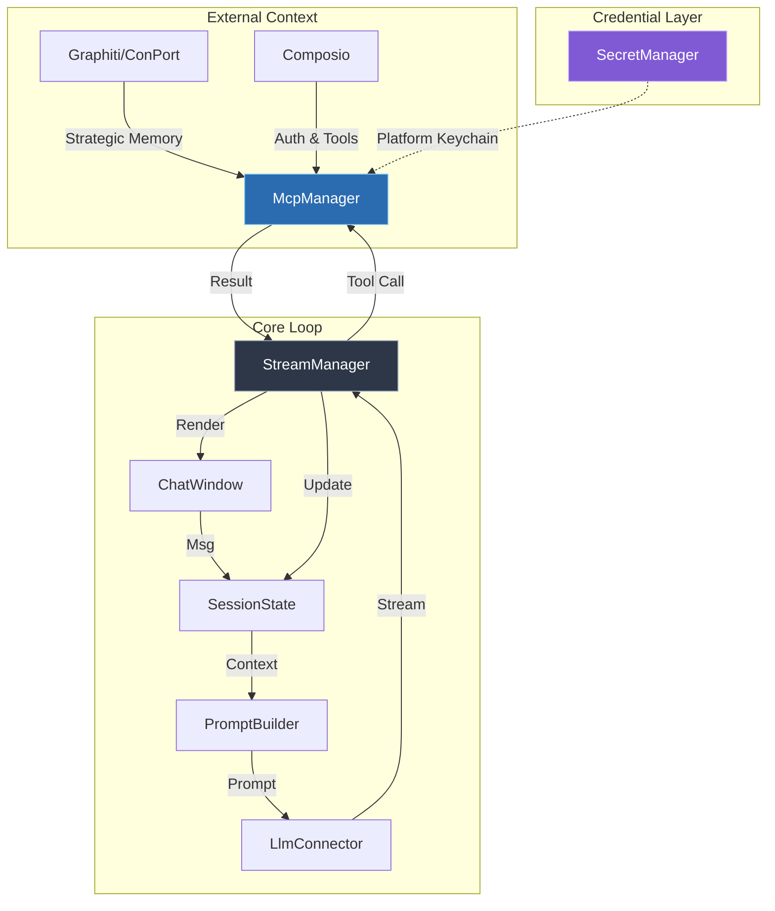

# SYSTEM_PATTERNS.md - Hobbes Beta Architecture & Critical Mandates

> **Version**: Beta (v0.9.x)  
> **Last Updated**: 2026-06-15

This document consolidates critical system patterns, anti-patterns, and architectural mandates for the Hobbes codebase. It serves as the authoritative reference for implementation patterns discovered through production experience.

---

## Architecture Overview

Hobbes creates a robust feedback loop between the User, LLM, and external Tools:



For detailed component documentation, see [ARCHITECTURE.md](ARCHITECTURE.md).

---

## Critical Mandates

These patterns are **non-negotiable** and their violation has caused production regressions.

### 1. Reactive Tool Synchronization

> **Pattern ID**: P-001  
> **Anti-Pattern**: Manual tool fetch in chat cycle

**NEVER** call `get_mcp_context().await` inside `send_message` or `PromptBuilder` cycles.

```rust
// ❌ ANTI-PATTERN: Causes stale state overwrites
let mcp_context = mcp_manager.read().get_mcp_context().await;
session.active_context.mcp_tools = Some(mcp_context);

// ✅ CORRECT: Trust the reactive sync
// McpManager maintains Signal → use_effect syncs to SessionState
```

**Why**: The `use_effect` in `ChatWindow` root already synchronizes the MCP context reactively. Manual fetches can skip "unload" updates or overwrite with stale data.

---

### 2. Composio OAuth Callback Pattern

> **Pattern ID**: P-002  
> **Anti-Pattern**: Missing callback_url

OAuth flows for Composio toolkits **MUST**:

1. Start local callback server on random port (30000-40000)
2. Include `callback_url` in the link request:
   ```rust
   serde_json::json!({
       "auth_config_id": auth_config_id, 
       "user_id": final_user_id,
       "callback_url": format!("http://localhost:{}/callback", port)
   })
   ```
3. Wait for Composio redirect to `http://localhost:{port}/callback`
4. Capture `connectedAccountId` from callback
5. Refresh connected accounts cache

**If broken**: OAuth completes on Composio side but app doesn't detect it.

---

### 3. Tool Names vs Toolkit Slugs

> **Pattern ID**: P-003  
> **Anti-Pattern**: Casing confusion

| Type | Casing | Example |
|------|--------|---------|
| **Tool Names** | UPPERCASE | `GMAIL_SEND_EMAIL` |
| **Toolkit Slugs** | Preserve API casing (usually lowercase) | `gmail` |

**Rules**:
- Cache toolkit slugs **exactly as Composio returns them**
- Use `.eq_ignore_ascii_case()` for matching
- Infer toolkit from tool name: `GMAIL_SEND_EMAIL` → `gmail`
- Auth config names (e.g., `mcp_gmail-mglu9n`) are **NOT** slugs

---

### 4. User-Filtered Account Caching

> **Pattern ID**: P-004  
> **Anti-Pattern**: Caching all accounts without filtering

Connected-account listings **MUST** be scoped to the target user. As of the
`composio_client/` split, this is enforced at the request layer — the listing
call sends the resolved user as `user_id` / `user_uuid` query params so the API
only ever returns that user's accounts:

```rust
let user_uuid = client.user_id.clone().or(client.entity_id.clone());
if let Some(uid) = &user_uuid {
    params.insert("user_id", uid.clone());
    params.insert("user_uuid", uid.clone());
}
```

**Location**: `src/mcp/composio_client/auth.rs` → `list_connected_accounts`

**If broken**: User A uses User B's credentials; OAuth never triggers for User A.

---

### 5. Cross-Platform Credential Abstraction

> **Pattern ID**: P-005 (Beta)  
> **Implementation**: Conditional compilation

```rust
#[cfg(target_os = "macos")]
mod secret_manager;        // Keychain + Biometric

#[cfg(not(target_os = "macos"))]
mod secret_manager_generic; // keyring crate
```

**Rules**:
- Both modules expose identical public API
- Biometric methods are stubs on non-macOS
- Never import `keychain_ffi` directly from components—use `secret_manager`

---

## Anti-Pattern Registry

| ID | Name | Symptom | Fix |
|----|------|---------|-----|
| AP-001 | Manual MCP Fetch | Disappearing tools, stale context | Use reactive sync only |
| AP-002 | Missing callback_url | OAuth hangs, toolkit limbo | Include callback in link request |
| AP-003 | Uppercase Toolkit Slugs | Gmail/Slack auth fails | Preserve API casing |
| AP-004 | Unfiltered Account Cache | Wrong credentials used | Filter by user_id |
| AP-005 | Direct keychain_ffi Import | Cross-platform build fails | Use secret_manager module |
| AP-006 | Direct Keychain Save Bypass | Duplicated fallback logic, inconsistent behavior | Use `save_secret_to_keychain()` or `SecretManager::set()` |
| AP-007 | Reversed MCP Lock Order | App deadlock (hangs forever) | Always lock `servers` before `dynamic_local_tools` |
| AP-008 | `use_memo` Over a Prop | Streaming code/markdown freezes at first chunk | Compute inline; reserve `use_memo` for Signals (P-012) |
| AP-009 | Built-in Tool Intercepted at One Call Site | Tool works normally, fails only after a permission approval | Add it to `dispatch_builtin_tool`, never to a call site (P-015) |
| AP-010 | Stream Mirror Skips Once Generating Ends | Finished reply cut off mid-sentence until a tab switch; DB has the full text | Reconcile from `session_state` at turn end; only a channel owner may skip (P-016) |

---

## Pattern References

For deeper documentation on specific subsystems:

| Topic | Document |
|-------|----------|
| Full Architecture | [ARCHITECTURE.md](ARCHITECTURE.md) |
| Composio API Surface | [COMPOSIO_ENDPOINTS.md](COMPOSIO_ENDPOINTS.md) |
| Security & Credentials | [SECURITY.md](SECURITY.md) |
| macOS Signing | [GUIDE_TO_APPLE_SIGNING.md](GUIDE_TO_APPLE_SIGNING.md) |
| Contributing | [CONTRIBUTING.md](CONTRIBUTING.md) |

### Module map: components/settings_panel/

| File | Owns |
|------|------|
| `mod.rs` | `SettingsPanel` (the only public item): every hook, the draft/sync effects, model-fetch effects, save + keychain-mode + conflict modals, the tab bar, the footer Save button, and a short `match` dispatching to tab components. Also defines `SettingsCtx`. |
| `shared.rs` | `INPUT` class string, `Toggle` switch, connector draft helpers (`load_instance_into_draft`, `selected_kind`, `flush_draft_into_instance`, `comparable`). |
| `calendar.rs` | Planner-tab calendar subscriptions: palette, ICS URL validation, `CalendarSubscriptionRow`, `CalendarSubscriptionsSection` (+ its unit tests). |
| `license.rs` | `LicenseSection` (About tab). |
| `trust_rules.rs` | `TrustRulesSection` (Permissions tab). |
| `terminal.rs` | `TerminalSection` (Behavior tab). |
| `fleet.rs` | `FleetSection` (Behavior tab). |
| `tabs/mod.rs` | Declares and re-exports the tab components. |
| `tabs/general.rs` … `tabs/about.rs` | One component per tab: `GeneralTab`, `McpTab`, `BehaviorTab`, `PlannerTab`, `DataTab`, `PermissionsTab`, `HotkeysTab`, `SkillsTab`, `AboutTab`. Credentials renders `ToolCredentials` directly; ImageGen is a one-line placeholder in the match. |

`SettingsCtx` is a `#[derive(Clone, Copy, PartialEq)]` bundle of the signals most tabs share (`settings`, `settings_manager`, `local_settings`, `ui_state`, `ui_state_manager`, `session_state`, `secret_manager`, `save_error`, `selected_connector_id`, `skill_registry`). Tab-specific signals are passed as individual `Signal<T>` props.

**Rule:** new settings tabs go in `tabs/<name>.rs` and receive shared state via `SettingsCtx` props, not new hooks. Any state that must survive switching tabs (drafts, collapse flags, modal state) is a hook in `SettingsPanel` passed down; calling `use_signal` inside a tab component resets it on every tab switch.

### Module map: mcp/manager/

`McpManager` is one type with several `impl McpManager` blocks, one per concern, in child modules (children can see the parent's private fields). Public paths are unchanged: everything is still `crate::mcp::manager::X`.

| File | Owns |
|------|------|
| `mod.rs` | Types only, plus `new` and the small state accessors: consts (`COMPOSIO_NATIVE_PREFIX`, `HOBBES_*_SERVER`), `is_composio_native`, `is_builtin_virtual_server`, `McpServerConfig`, `McpContext`, `McpServerContext`, `ServerStatus`, `McpServerStatus`, `McpClientType`, `ActiveMcpClient`, `AuthRequiredInfo`, the `McpManager` struct; `new`, `inject_custom_credentials`, `set_initial_*`, `set_server_on_demand`/`set_server_loaded`, `is_server_loaded`, `get_client`. Re-exports the `pub(crate)` Composio key helpers. |
| `lifecycle.rs` | Server start/stop: `launch_servers`, `retry_server`, `reconnect_stdio_server`, `install_mcp_server`, `load_server`, `unload_server`, `reload_config`, `clear_dynamic_tools_for`, terminal reaping/shutdown, `get_sane_path`, `get_critical_env_vars`, `is_auth_error`, `is_needs_setup_error`. |
| `tool_call.rs` | Tool execution: `use_mcp_tool`, `process_tool_output`, `try_auth_recovery`, `get_local_meta_tools`, `score_tool_relevance`, `GEMINI_TOOL_LIMIT`. |
| `composio.rs` | Composio key resolution and purge helpers (`composio_server_key`, `resolve_composio_key`, `ComposioKeyLookup`, `purge_composio_profile_state`, + their tests) and the profile/client methods: native client init/reinit, `find_composio_client`, `composio_client_for_profile`, `get_composio_toolkits`, `recreate_composio_server`, `initiate_composio_auth`. |
| `composio_toolkits.rs` | Per-toolkit tool operations: `connect_toolkit`, `remove_toolkit`, `reload_composio_tools`, `set_composio_toolkit_tools`, `rollback_partial_connect`, `clear_dynamic_tools_for_toolkit`, `get_composio_toolkit_tool_state`. |
| `config.rs` | `mcp_servers.json` persistence: `load_configs`, `save_configs`, `add_or_update_mcp_server`. |
| `oauth.rs` | `start_oauth_flow`, `complete_oauth_flow`. |
| `status.rs` | `get_mcp_context`, `get_all_server_statuses`, `invalidate_status_cache(_async)`. |

**Rule:** new `McpManager` methods go in the module for their concern as a separate `impl McpManager` block; `mod.rs` holds types only. A private method called from a sibling module is `pub(super)` — no wider.

### Module map: components/planner_rows/

The Things-style planner list surfaces (centre column, quick-add, list, row). Public paths are unchanged: everything is still `crate::components::planner_rows::X`; `mod.rs` re-exports (with the same `pub(crate)` visibility) only what other components import.

| File | Owns |
|------|------|
| `mod.rs` | Module docs, `mod` declarations, the `pub(crate)` re-exports, and the shared style consts (`DEFAULT_PROFILE_COLOR`, `PILL`, `META`, `BTN_*`, `POPOVER`, `MENU_*`, `SECTION_HEADER`, `KEY_RING`). Child modules read the consts via `use super::{…}`; they stay private. |
| `centre.rs` | `CentreColumn` (entry point, used by `planner_view.rs`), `ListOrderControl`, `GroupHeader`. |
| `quick_add.rs` | The quick-add flow: `QuickAdd`, `QuickAddField`, `QuickAddPreview`, `QuickAddDraft`, `Inherited`/`InheritedFrom`, `BirthProject`/`Birth`, `resolve_birth`, `commit_quick_add`, `apply_project_pick`, `create_project`, title/highlight helpers (+ birth tests). Also consumed by `quick_capture.rs`. |
| `list.rs` | `Section`, `TodoList` (grouping, drag wiring, adopt-undo), `ProjectPicker`. |
| `row.rs` | `TodoRow` (the WHO / WHAT / WHEN grid and its popovers) and the `RowMenu` state enum. |
| `reorder.rs` | Manual-order math (`Reorder`, `reorder_target`, `moved`, `drag_over_index`, `flatten_with`), drag/undo plumbing (`ListDrag`, `ListDragContext`, `AdoptUndo`, `UNDO_GENERATION`), FLIP helpers (`bump_flip`, `flip_snap`), `apply_move`. |
| `schedule.rs` | `ScheduleChoice`, `apply_schedule_choice`, `current_schedule_choice`, `set_schedule` (also used by `todo_detail.rs`), `DueTone`/`due_tone`/`due_tone_class`, `date_pill_label`. |
| `helpers.rs` | Pure display and selection helpers: `WhoState`/`who_state`, `cycle_estimate`, `activation_seed`, profile swatch classes, `working_minutes`, `view_title`, `empty_state_line`, `todos_for_selection`, `first_block_on_day`, `block_slots`, `priority_tone_class`, `order_hint`. |
| `test_support.rs` | `#[cfg(test)]` helper shared by more than one file's tests (`d`, a date parser). Other test helpers live beside their tests. |

Tests sit in a `#[cfg(test)] mod tests` at the bottom of the file that owns the code under test.

**Rule:** new planner row/list UI goes in the file for its concern; shared style consts live in `mod.rs`. A private item used from a sibling module is `pub(super)` — no wider. `TodoRow` is deliberately one ~1,000-line component: splitting it means moving hooks, so don't do it as a drive-by.

---

*This document supersedes `memory-bank/systemPatterns.md` as of Beta release.*

---

## Patterns Added in v0.9.53

### 6. Auth Recovery — 6-Point Reconnect Lifecycle

> **Pattern ID**: P-006  
> **Replaces**: Ad-hoc self-repair in `execution.rs` (deprecated)

When a tool call fails with 401/403, the system runs a full 6-point reconnect:
1.  **Hydrate `auth_config_cache`** via `list_auth_configs`
2.  **Resolve `auth_config_id`** (cache → API → create)
3.  **Delete stale ACTIVE connections** + bust `toolkit_account_map`
4.  **Initiate OAuth** with `force=true` (bypasses ACTIVE safety check)
5.  **Re-patch MCP server** to ensure toolkit + auth_config binding
6.  **Re-hydrate `toolkit_account_map`** via `list_connected_accounts`

> [!IMPORTANT]
> Step 6 is critical. Step 3 busts the cache entry, and without Step 6 the next tool call's
> proactive check sees an empty cache, concludes there's no connection, and fires another
> reconnect — destroying the brand-new credentials.

After successful re-auth, `try_auth_recovery()` returns `is_error: Some(false)` to let the LLM pace the retry. Internal retries are an **anti-pattern** (see below).

> [!WARNING]
> **Anti-Patterns** (confirmed Feb 2026):
> - **Internal retry after reconnect**: Immediate retry hits proxy before token propagates → 401 → infinite browser loop
> - **Fallthrough after proactive reconnect**: Same issue — executes tool before token syncs → 401 → `try_auth_recovery` fires second reconnect
> - **Case-sensitive cache keys**: `toolkit_account_map` keys must be **lowercase**. API slug casing varies between endpoints.

**Location**: `src/mcp/composio_client/mod.rs` → `reconnect_toolkit()`, `src/mcp/manager/tool_call.rs` → `try_auth_recovery()`

---

### 7. Single-Authority Auth Detection

> **Pattern ID**: P-007  
> **Replaces**: Duplicated substring matching in `execution.rs` and `manager.rs` (deprecated)

All auth error detection is centralized in `ToolExecuteResponse::is_auth_error()` covering 6 patterns: `status_code`, `statusCode`, `ECODE`, `http_error`, nested `data.data`, and error string fallback.

**Location**: `src/mcp/composio_client/models.rs`  
**If broken**: Auth failures silently pass through without triggering recovery.

---

### 8. Dynamic Tool Injection (OnDemand Mode)

> **Pattern ID**: P-008  
> **Anti-Pattern**: Loading all 200+ tools upfront into every Gemini request

`COMPOSIO_GET_APP_TOOLS` discovers tools, deduplicates, applies budget-aware selection (capped at `GEMINI_TOOL_LIMIT = 128`), and injects into `dynamic_composio_tools` cache as native `rmcp::Tool` objects.

`COMPOSIO_CLEAR_TOOLS` flushes the cache. `build_mcp_context()` includes dynamic cache as a virtual server.

**Location**: `src/mcp/manager/tool_call.rs` (`use_mcp_tool`, `GEMINI_TOOL_LIMIT`)

---

### 9. Serialize-Then-Move Persistence

> **Pattern ID**: P-009  
> **Replaces**: Clone-based `save_async(state: SessionState)` (deprecated)

**NEVER** clone `SessionState` for async saves. Serialize to `Vec<u8>` on the calling thread, move only the bytes to background I/O.

```rust
// ❌ DEPRECATED: Deep clone of all sessions + messages
SessionState::save_async(state.clone(), None);

// ✅ CORRECT: Borrow, serialize, move bytes
SessionState::save_async(&state, None);

// ✅ CORRECT: After releasing a write guard on a Signal
SessionState::save_signal(&session_state, None);
```

**Location**: `src/session.rs`, `src/async_persist.rs`

---

### 10. MCP Lock Ordering Invariant

> **Pattern ID**: P-010  
> **Anti-Pattern**: Reversed lock acquisition (ABBA deadlock)

When acquiring multiple MCP manager locks, always follow this order:

```
servers → dynamic_local_tools → dynamic_composio_tools
```

`call_tool` acquires `servers` first (line ~1655), then falls back to `dynamic_local_tools` (line ~1762). Any function that needs both locks must acquire them in the same order.

**If broken**: ABBA deadlock — app hangs permanently when a user switches a server mode while a tool call is in-flight.

---

### 11. Centralized Keychain Save Helper

> **Pattern ID**: P-011  
> **Anti-Pattern**: Direct `keychain_ffi` calls from UI components (AP-006)

All keychain save operations must use `SecretManager::set()` or the standalone `save_secret_to_keychain()` helper. Never call `set_generic_password_with_biometric_protection` / `set_generic_password_local` / `set_generic_password` directly from components.

```rust
// ❌ ANTI-PATTERN: Duplicated fallback logic in each component
keychain_ffi::set_generic_password_with_biometric_protection(key, value)
    .or_else(|e| { /* fallback logic */ });

// ✅ CORRECT: Single source of truth
crate::secret_manager::save_secret_to_keychain(key, value, use_biometric)
```

**Location**: `src/secret_manager.rs` → `save_secret_to_keychain()`

---

### 12. Never `use_memo` Over a Non-Signal Prop in a Streaming Render

> **Pattern ID**: P-012  
> **Anti-Pattern**: Memoizing a computation that depends on a plain prop

In Dioxus 0.6, `use_memo` only re-runs when a captured **Signal** changes. A memo
that depends on a plain prop (e.g. a `String` `code`/`lang` passed into a child)
captures that value **by reference on first render and never recomputes** — even
though the parent re-renders the child with new prop values on every streaming
chunk.

```rust
// ❌ ANTI-PATTERN: freezes at the first streamed chunk
let highlighted = use_memo(move || highlight(&code, &lang)); // code/lang are props

// ✅ CORRECT: compute inline so it tracks the re-rendered props
let highlighted = highlight(&code, &lang);
```

**Symptom**: a syntax-highlighted code block (or rendered markdown) whose content
and height freeze at the first chunk and only correct after a remount — e.g.
switching tabs and back.

**Rule**: inside a component that renders streaming text, derive from props
**inline**. Reserve `use_memo` for values derived from Signals. Both known
hot spots carry an inline `⚠️ DO NOT WRAP THIS IN use_memo ⚠️` warning — do not
"optimize" them back into a memo.

**Location**: `src/components/chat.rs` → `CodeBlock`, `src/components/markdown_renderer.rs`

---

### 13. Model Pricing Tables Are Manually Maintained (and Drift)

> **Pattern ID**: P-013  
> **Anti-Pattern**: Trusting a hardcoded price as current

Per-token cost estimation uses **hand-maintained** USD-per-1M-token tables, one
per provider. Provider pricing changes (new models, rate cuts, renamed tiers),
so these tables **drift out of date** and must be re-verified periodically
against the official pricing pages.

| Provider | Table | Pricing page |
|----------|-------|--------------|
| OpenAI | `src/llm/openai_pricing.rs` → `PRICES` | developers.openai.com/api/docs/pricing |
| Gemini | `src/llm/gemini.rs` → `GeminiModel::get_rates` | ai.google.dev/gemini-api/docs/pricing |
| Claude | `src/llm/claude_models.rs` → `input_price_per_mtok` / `output_price_per_mtok` / `cache_read_price_per_mtok` | platform.claude.com/docs/en/about-claude/pricing |

> **Last verified**: 2026-06-17 (all three confirmed against published rates).

**Rules**:
- Match models by **family with a version/dash boundary**, never a bare
  `starts_with`. `gpt-5.1` must NOT inherit `gpt-5` pricing — see
  `openai_pricing::matches_family`. A loose prefix silently mis-prices new
  minor versions.
- **Unknown model → no cost** (`None`), never a fabricated or nearest-guess
  price. An absent number is honest; a wrong one is not.
- Cost is only charged for **paid, first-party APIs**. The OpenAI connector
  gates on `billable()` (api key + `api.openai.com`); local/self-hosted/keyless
  endpoints are free.
- When you touch a table, bump the **Last verified** date above.

**If broken**: the in-app cost counter and `usage_log` totals quietly diverge
from the real bill.

---

### 14. Composio Toolkit Removal & Auth-Config Hygiene

> **Pattern ID**: P-014
> **Anti-Pattern**: Create-or-find auth configs with no deletion → wedged servers

All Composio toolkits for a profile bind to **one shared MCP server**. Its
`toolkits` + `auth_config_ids` arrays are the choke point: a PATCH is fail-fast,
so a single stale/duplicate/invalid `auth_config_id` makes **every** future
connect (and even a removal PATCH) reject — the server is "wedged". The historical
fix was to hand-create a fresh server in the Composio dashboard.

**Removal** (`McpManager::remove_toolkit`) mirrors the connect lifecycle in
reverse: `remove_toolkit_from_server` PATCH (drop the slug from `toolkits`,
`auth_config_ids`, `allowed_tools`; Mandate 5 + regenerate per Mandate 6) →
`delete_connected_account` for the toolkit's accounts → `delete_auth_config` for
the dropped ids → drop its on-demand tools (profile-keyed bucket) + settings
`toolkit_configs` entry (UI-side). Pure array planning lives in
`compute_toolkit_removal` (unit-tested).

**Hygiene rules** (all reuse `delete_auth_config`):
- **Dedupe on connect** — `get_auth_config_id` keeps one config per slug and
  deletes the rest; the reconciliation in `add_toolkit_to_server` re-points the
  server at the survivor.
- **Rollback on failed connect** — `connect_toolkit` deletes the auth
  config/account it created **only when the toolkit had none before**
  (`has_existing_auth_config`), so a failed attempt leaves no orphan and never
  touches an already-connected toolkit's state.
- **Recreate to recover** — `recreate_composio_server` resolves auth for the kept
  toolkits, provisions a fresh server **seeded with the first** toolkit
  (`create_fresh_mcp_server` — Composio rejects an empty server, error 1153), then
  binds the rest (re-applying the locally persisted per-toolkit `enabled_tools`
  curation), repoints `base_url` + the servers map, then soft-deletes the old
  server (`delete_mcp_server`, `DELETE /api/v3/mcp/{id}`) so abandoned servers
  don't accumulate and can't be mis-targeted later. This is the **only**
  recovery for an already-wedged server.

**If broken**: connects fail with 400s on the shared server; removals also fail;
the only escape is Recreate.

---

### 15. Built-in Tools Have Exactly One Dispatch Point

> **Pattern ID**: P-015
> **Anti-Pattern**: Intercepting a `HOBBES_*` tool at one call site but not the other (AP-009)

Built-in ("virtual server") tools are intercepted **before** MCP dispatch because
they operate on `SessionState`, the skill registry, and the permission manager —
state `McpManager` does not own. `McpClientType::NativeCore` therefore has no
executor: reaching it means interception was missed, and it returns an explicit
*"was not intercepted before MCP dispatch. This is a Hobbes bug"* error.

There are **two** paths that execute tool calls:

| Path | Location | When |
|------|----------|------|
| Streaming | `src/components/stream_manager.rs` | Normal turn |
| Approval resume | `src/components/chat.rs` | Re-runs calls left `Running` after the user approves them |

Both route through `dispatch_builtin_tool` in
`src/components/builtin_tools.rs`, which returns `Some(BuiltinOutcome)` for a
built-in and `None` to fall through to MCP.

**Rules**:
- **Add new built-ins to `dispatch_builtin_tool` only** — never inline at a call
  site. That is how the two paths drifted before: `HOBBES_SET_TIMER` and
  `HOBBES_INVOKE_SKILL` were handled only on the streaming path, so they worked
  normally and hit the NativeCore bug error whenever the turn happened to resume
  from an approval. Intermittent by nature, and invisible in any test that
  doesn't involve a permission prompt.
- **`BuiltinOutcome.persist`** carries whether the caller must
  `SessionState::save_async` afterwards. Pagination is turn-local (`false`); the
  scratchpad, skills, and timers must survive a restart (`true`).
- **The dispatcher only computes the result.** Writing it back into the message,
  persisting, and recording tool-call history stay with each caller, because the
  two sites genuinely differ there.
- `BUILTIN_TOOLS` is documentation plus a test fixture — it is deliberately
  **not** consulted as an early-out in the dispatcher. A guard would mean a new
  match arm whose name was omitted from the list silently fell through to MCP,
  trading a loud failure for a quiet one.

**Test**: `every_core_client_tool_is_dispatchable` asserts every tool advertised
by `CoreClient::list_tools` is listed in `BUILTIN_TOOLS`, so a tool added to the
schema but not the dispatcher fails the build rather than the user's next
approval.

**If broken**: the tool works in most turns and errors only after a permission
prompt — the hardest possible failure to reproduce from a bug report.

---

### 16. A Finished Turn Is a Reason to Sync, Never a Reason to Skip

> **Pattern ID**: P-016
> **Anti-Pattern**: Gating a streaming bubble's `session_state` mirror on "still generating" (AP-010)

`MessageBubble` renders a local `content` signal seeded at mount. It is fed one
of two ways: the bubble that mounted empty owns the single-consumer stream
channel and appends chunks; every other bubble (re-mounted after a tab switch,
or mounted late because a live activity block absorbed the empty placeholder —
i.e. every reply that follows tool calls) mirrors the text the stream task
writes into `session_state` on each chunk.

The stream task does not yield between chunks that are already buffered, and
the final leg's cleanup (`summarize_and_cleanup`, the closed tool-results
channel) is synchronous. So when rendering a long reply falls behind, the last
chunks, the persisted final text **and** the removal of the generating flag all
land in one poll. The mirror effect's next run sees `is_generating == false`;
if it bails out there, the bubble stays frozen at an earlier chunk forever.

**Symptom**: a long reply after tool calls stops mid-table or mid-sentence;
the footer shows final tokens and cost; `sessions.db` holds the full text; a
tab switch (remount re-seeds `content` from the prop) fixes it.

**Rules**:
- The mirror skips **only** while this bubble owns a still-open channel.
  Everyone else mirrors, generating or not (`should_mirror_session_text`).
- The channel owner clears `owns_channel` when its loop ends, and the mirror
  reads that flag reactively, so the owner gets the same end-of-turn
  reconcile. Never reconcile an owner before its channel drains — the loop
  would then append the buffered tail a second time.
- Don't "optimise" by early-returning on a stream state flag before comparing
  against `session_state`; the compare is the cheap part.

**Location**: `src/components/chat.rs` → `MessageBubble` (mirror effect,
`should_mirror_session_text`)

**Test**: `finished_turn_still_reconciles_from_session_state`.

**If broken**: the end of long replies silently goes missing on screen while
persistence, cost and history all look correct.
